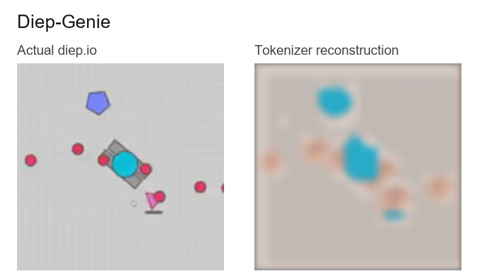

# Diep-Genie

Can a small model learn a controllable diep.io world from gameplay video alone? A compact Genie-style prototype explores that question.

No playable world model exists. Both new tokenizer tests completed 5,000 updates, and all training is stopped. Known barrel detail remains unresolved.

Currently implemented features include local video curation, a causal VQ tokenizer, latent-action and token-dynamics modules, and reconstruction diagnostics.

## Completed tokenizer checkpoint

A fresh CNN with 32 codebook entries and a similarly sized causal transformer with 32 entries were compared with the historical 512-entry CNN. Each new run received 5,000 updates with matched training exposure. Lower error is better; these averages do not count retained objects or barrels.

| Model at 5,000 updates | Whole-image error | Colored-area error | Temporal-change error |
| --- | ---: | ---: | ---: |
| Historical CNN, 512 entries | 0.00465634 | 0.01054142 | 0.00287102 |
| CNN, 32 entries | 0.00342963 | 0.01875977 | 0.00288443 |
| Small transformer, 32 entries | 0.00601435 | 0.03892347 | 0.00437114 |

The same known five-barrel case remains unresolved in all three models. The smaller CNN's lower average image error came with higher colored-area error. The transformer used 7 of 32 codes on these validation clips; its two most common codes covered about 92% of assignments. That is a warning to investigate, not proof of a cause, and background occupies most pixels.

These are single-run, small-budget results, with a historical backend difference and a custom training loss. The 5,000-update cutoff matches exposure and does not establish convergence. Both runs finished, compute was released, and the launchers were disabled. Conservative accounting including setup was about 3.23 compute units within the approved 4.5-unit ceiling. [Results and limitations](configs/small-codebook-architecture-v4-results.json).

[Explore Data and Reconstructions](https://jackgao1540.github.io/Diep-Genie/) · [Genie paper](https://arxiv.org/abs/2402.15391)

Gameplay credit: SinbadX / MasterOv / diep.io, from the approved public sample linked in the explorer.
