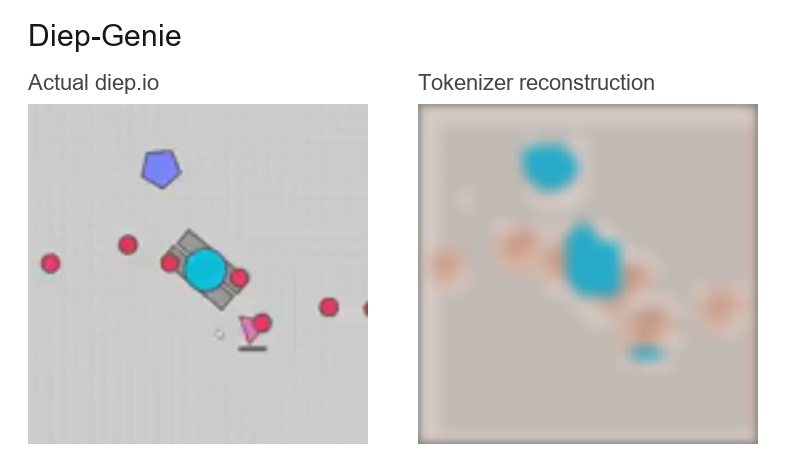

# Diep-Genie

Can a small model learn a controllable diep.io world from gameplay video alone? A compact Genie-style prototype explores that question.

Currently, no playable world model exists. Figuring out why details are being lost from reconstruction and codebook seemingly is not being populated and used properly.

Currently implemented features include local video curation, a causal VQ tokenizer, latent-action and token-dynamics modules, and reconstruction diagnostics.

[Explore Data and Reconstructions](https://jackgao1540.github.io/Diep-Genie/) · [Genie paper](https://arxiv.org/abs/2402.15391)

Gameplay credit: SinbadX / MasterOv / diep.io, from the approved public sample linked in the explorer.
